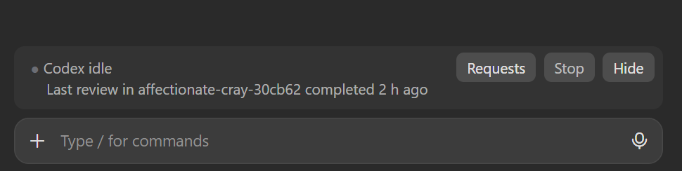
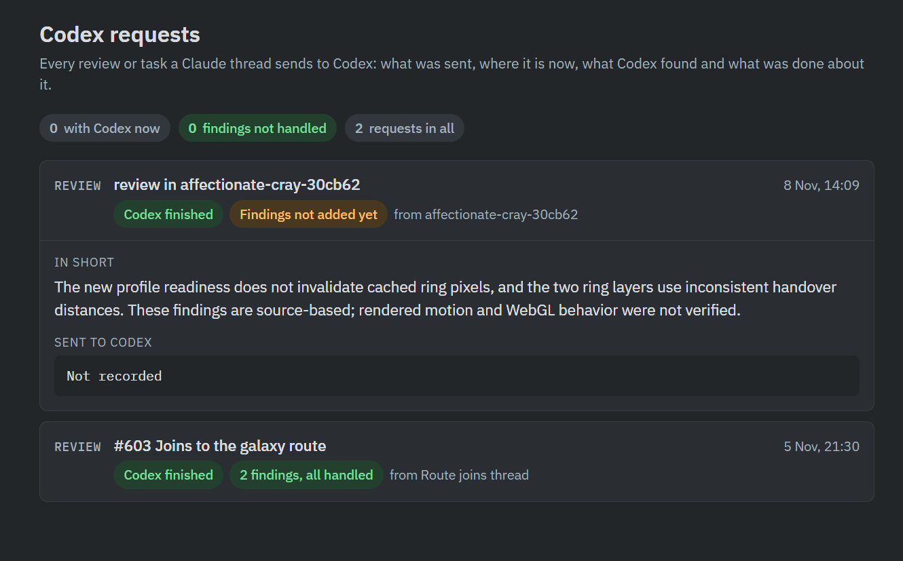

# codex-infoband-forclaude

A Claude Code mod, `codex-band`, that adds one line above the prompt showing what Codex is doing: the running review or task (kind, worktree, phase, minutes), or when the last one finished. It also keeps a Codex Band Requests page on claude.ai, where each request, its findings and what was done about them are listed.

It reads the [Codex plugin for Claude Code](https://github.com/openai/codex-plugin-cc)'s own job records under `~/.claude/plugins/data/<codex plugin>/state/*/state.json` every 15 seconds. So live status only shows on the computer where the Codex plugin runs. On another computer running Claude Code without the Codex plugin, it shows the jobs listed on your requests page instead (read every 30 seconds), and Stop points you to the desktop. Cloud sessions (claude.ai/code tasks) show no band at all: they don't install plugins from a repository's `.claude/settings.json`, and they don't draw what a mod draws. From a cloud task, follow Codex on your requests page, or drive a desktop session with `/remote-control`, where the band is drawn. It stays hidden in a new chat until the session involves Codex: a Codex hand-off (the companion script, a Codex skill or the Codex subagent, shown while it waits for permission), a `/codex:*` command, or a Codex job this session started. `Hide` hides it until Codex comes up again; `/codex-band` shows it, `/codex-band hide` hides it. The first time a session has a Codex job to log, the mod looks for a claude.ai page of yours titled "Codex Band Requests" and, if there is none, creates one (with the usual permission prompt; this needs Claude Code signed in to claude.ai). It remembers the page from then on. Each Codex job a session starts gets a row on that page (doc id = the Codex job id), written by the mod and updated as the job runs and finishes; the mod approves only its own writes to that page's `requests` list. The thread adds the findings and what was done to that row. On the page, a request moves to Archived 14 days after it was sent once Codex is done and every finding is handled, and a toggle at the top switches between Active, Archived and All. The cog at the top right sets how long Codex must be idle before the band hides itself (10 minutes by default, 0 to keep it up; the band comes back with the next Codex hand-off), the archive age and can turn on deleting archived requests after a number of days (off by default). Deleting removes only the request's entry from the page; Codex's own job records, your code, branches and pull requests are untouched. A light at the left pulses while a job runs. The light and status share a row with three buttons: Details opens your page in the browser, Stop (dim while nothing runs; press twice) cancels that job through the Codex plugin's own cancel, and Hide.



The Codex requests page the band links to and logs each Codex job on:



## Install

```
claude plugin marketplace add andrewchallis/codex-infoband-forclaude
claude plugin install codex-band@codex-infoband-forclaude
```

Then run `/reload-plugins` in any open session. To get a newer version later: `claude plugin marketplace update codex-infoband-forclaude`, `claude plugin update codex-band@codex-infoband-forclaude`, then `/reload-plugins`.

If you installed it from the universe-lab repository before, remove that copy first:

```
claude plugin uninstall codex-band@universe-lab
claude plugin marketplace remove universe-lab
```

## Layout

- `.claude-plugin/marketplace.json`: the marketplace, one plugin.
- `plugins/codex-band/`: the mod (`hooks/register.tsx`, its state types in `types/index.d.ts`).
